# 02 — Architecture

| | |
|---|---|
| Document status | Draft for Milestone 0 review |
| Related | [Requirements](01-requirements.md) · [Interface contract](03-api.md) · [Threat model](04-threat-model.md) · [ADRs](adr/README.md) · [Diagrams](diagrams/README.md) |

> **How to read this document.** It goes from the outside in: first the system in its environment (§1), then its building blocks (§2–3), how they collaborate over time (§4–6), what data they keep (§7), the scoring rules (§8), where the code lives (§9), and the concerns that cut across everything (§10). Every diagram has an editable source in [`docs/diagrams/`](diagrams/README.md).

## 1. Context

SecureWaste is a single web application that runs on the user's own computer. There is no external service: no cloud API, no AI provider, no e-mail.

| Actor / system | Interaction |
|---|---|
| **Analyst** (Sana, Youssef) | Uploads documents, reads findings, reviews them, requests redactions and reports, deletes documents |
| **Compliance reviewer** (Leila) | Reads dashboards and reports; in the MVP uses the same single local account as the analyst |
| **Developer / CI** | Builds, tests and audits dependencies through GitHub Actions; never touches real data |
| **Local file system** | Holds originals and sanitized copies under `instance/storage/` |
| **SQLite file** | `instance/securewaste.db` — metadata, findings (masked), audit events |

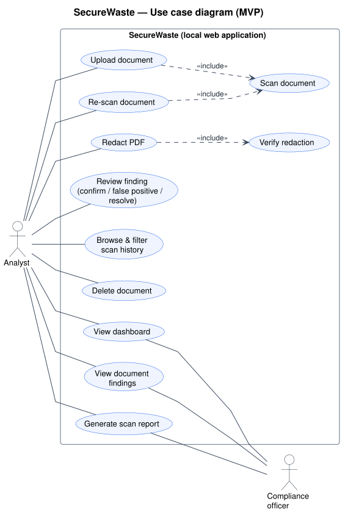

*Reading the diagram:* stick figures are **actors** (people or systems outside SecureWaste), ellipses are **use cases** (goals an actor achieves), and the rectangle is the **system boundary**. «include» means a use case always runs another; «extend» means it optionally adds behaviour.

## 2. Architectural style

A **layered monolith** with a strict dependency direction:

```
web (Flask routes, templates)  →  services (use-case orchestration)  →  core (pure logic)  
                                         ↓
                                 db (repositories)  +  storage (files)
```

- **`web`** knows HTTP. It parses requests, calls one service function, and renders a template or JSON. No business rules.
- **`services`** coordinate a use case ("scan this document", "change review status") inside one database transaction.
- **`core`** contains the valuable logic — validation, extraction, detection, masking, risk, redaction, reporting — as plain Python with **no Flask import**, so it can be unit-tested in milliseconds and reused later by a CLI or worker.
- **`db`** hides SQL behind small repository functions.

Why a monolith and not microservices? One process, one database file and one language are enough for small documents and a five-person student team. The layer boundaries are where we would split later (e.g. moving `core` behind a queue worker). See [ADR-0002](adr/0002-flask-server-rendered-ui.md).

## 3. Components

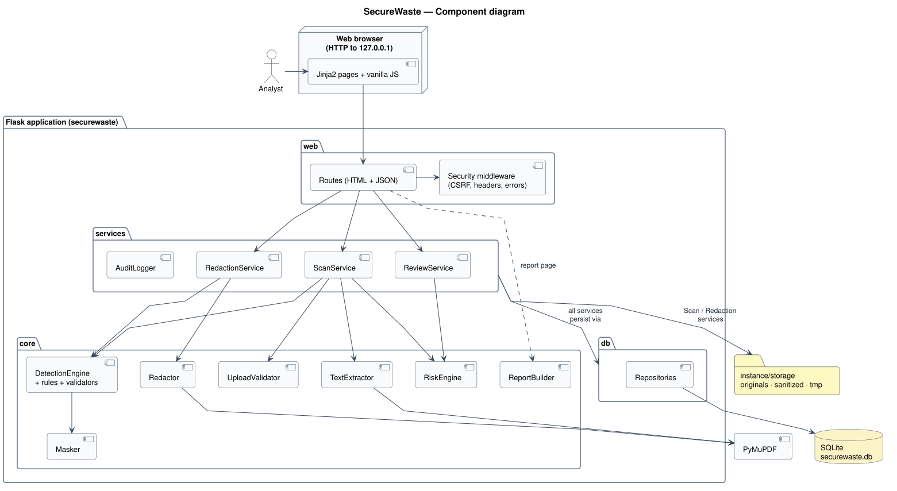

*Reading the diagram:* each box with the «component» tab is a replaceable part with a clear responsibility; arrows are "uses" dependencies and point from the user of a service to its provider. Cylinders and folders are data stores.

| Component | Module | Responsibility |
|---|---|---|
| Web UI | `web/templates`, `web/static` | Server-rendered pages (dashboard, upload, history, document, redaction, report) + small vanilla-JS enhancements |
| Routes | `web/routes_*.py` | HTTP endpoints from [03-api.md](03-api.md), CSRF, error pages |
| Security middleware | `web/security.py` | Security headers, CSP, request size limit, error handlers that never leak details |
| Scan service | `services/scan_service.py` | Orchestrates upload → store → extract → detect → assess → persist → audit |
| Review service | `services/review_service.py` | Validates review transitions, records actions, triggers re-assessment |
| Redaction service | `services/redaction_service.py` | Re-locates selected values, calls the redactor, verifies, records result |
| Upload validator | `core/upload.py` | Size, magic bytes, UTF-8 check, PDF open/encryption/page checks, safe names |
| Text extractor | `core/extraction.py` | Page-aware text for PDF (PyMuPDF) and TXT |
| Detection engine | `core/detection/engine.py` | Runs enabled rules, merges duplicates, applies `MIN_CONFIDENCE` |
| Rules & validators | `core/detection/rules/`, `validators.py` | One class per category; Luhn, IBAN mod-97, context words |
| Masker | `core/detection/masking.py` | Turns raw values into display-safe masks and keyed hashes |
| Rule catalogue | `core/detection/catalogue.py` | Weights, severities, explanations, recommendations, `RULESET_VERSION` |
| Risk engine | `core/risk.py` | Score, level, floors, human-readable reasons |
| Redactor | `core/redaction.py` | PyMuPDF redaction, metadata scrubbing, verification |
| Report builder | `core/reporting.py` | Builds the report view-model (masked data only) |
| Repositories | `db/repositories.py` | Parameterised SQL for every table |
| Audit logger | `services/audit.py` | Writes audit events with a fixed, value-free schema |

## 4. Deployment

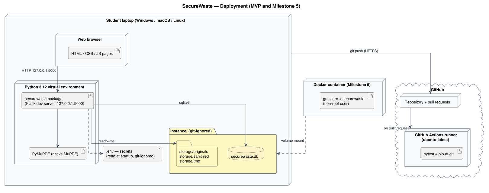

*Reading the diagram:* 3-D boxes are **nodes** (machines or execution environments), inner boxes are **artifacts** deployed on them, and lines are communication paths labelled with their protocol.

- **MVP:** Flask development server bound to `127.0.0.1:5000` inside a Python 3.12 virtual environment. Data lives in `instance/` (git-ignored).
- **Milestone 5:** a Docker image running `gunicorn` as a non-root user, with `instance/` as a mounted volume and the port published to `127.0.0.1` only.
- **CI:** GitHub Actions runs `pytest` and `pip-audit` on Ubuntu for every pull request. CI uses only synthetic fixtures.

## 5. Main scenarios (sequence diagrams)

*Reading a sequence diagram:* participants are columns; time flows **downwards**; solid arrows are calls, dashed arrows are returns; `alt` frames are if/else branches, `loop` frames repeat, and activation bars show who is busy.

### 5.1 Upload and scan (US-01 → US-09)

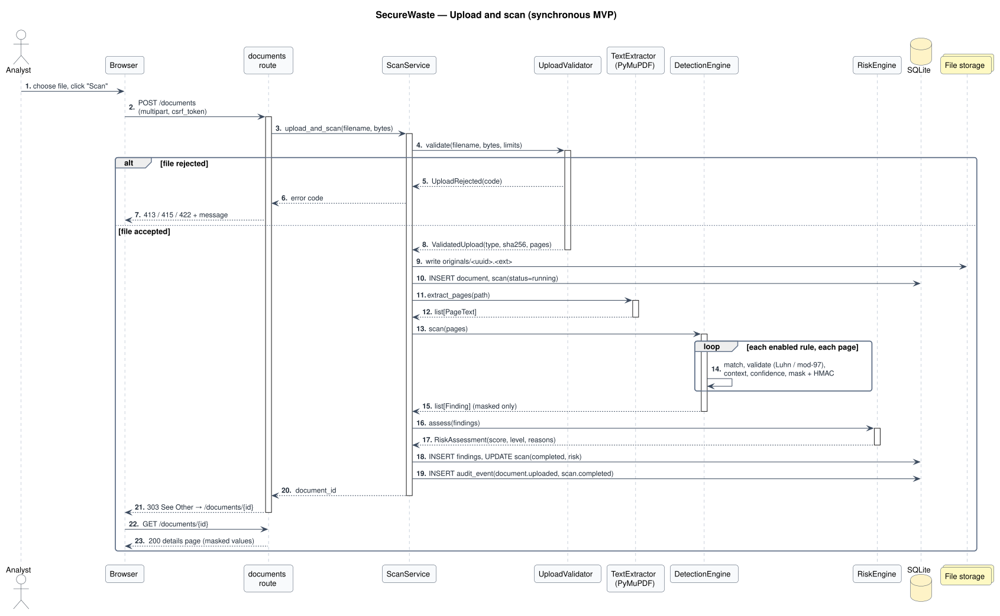

The scan runs **synchronously** inside the upload request (files ≤ 10 MB, ≤ 100 pages). The scan job still moves through `queued → running → completed/failed`, so a background worker can be introduced later without changing the data model ([ADR-0007](adr/0007-synchronous-scan-with-job-states.md)).

### 5.2 Review a finding (US-13)

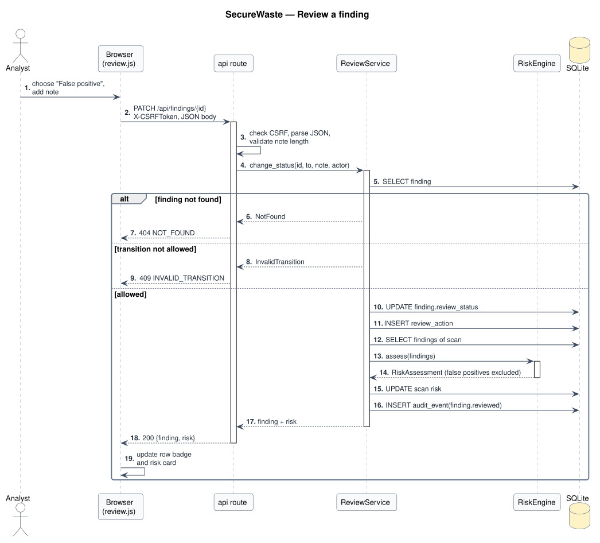

### 5.3 Redact a PDF (US-17, US-18)

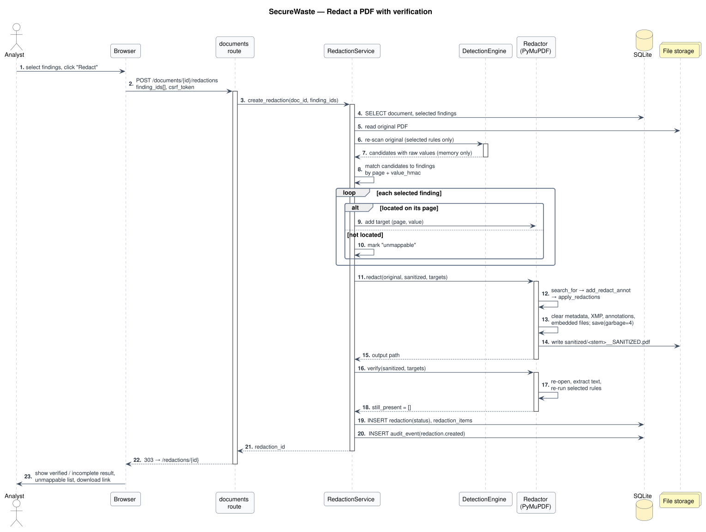

Because the database never stores raw values, the redaction service **re-runs the selected rules on the original file in memory**, matches candidates to the chosen findings through their keyed hash (`value_hmac`), and only then asks PyMuPDF to locate and remove them. Raw values exist only in memory during that request ([ADR-0006](adr/0006-store-masked-values-and-keyed-hashes.md), [ADR-0009](adr/0009-verified-true-redaction.md)).

### 5.4 End-to-end workflow (activity diagram)

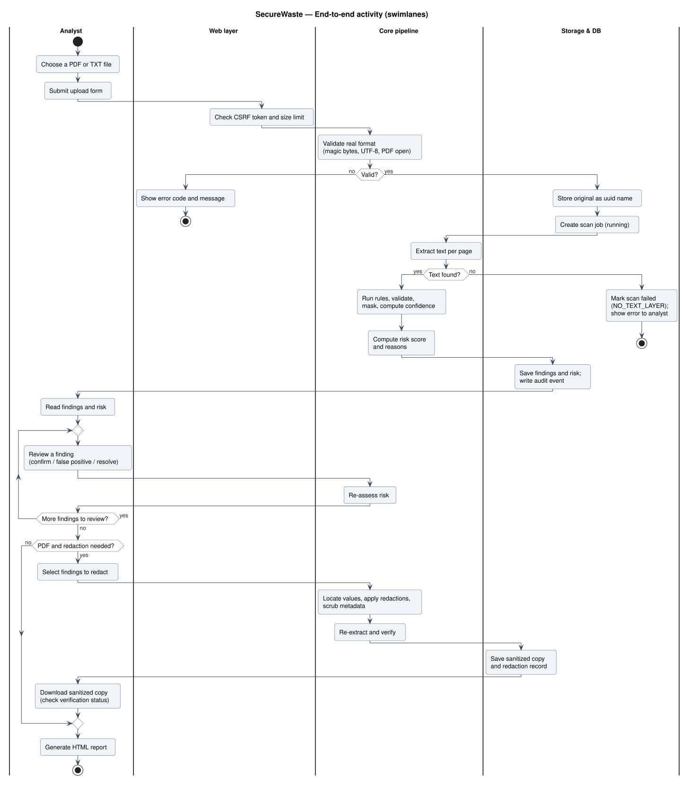

*Reading the diagram:* each vertical **swimlane** is a responsible party; rounded boxes are actions, diamonds are decisions with guarded exits `[condition]`, the black dot is the start and the ringed dot the end.

## 6. State machines

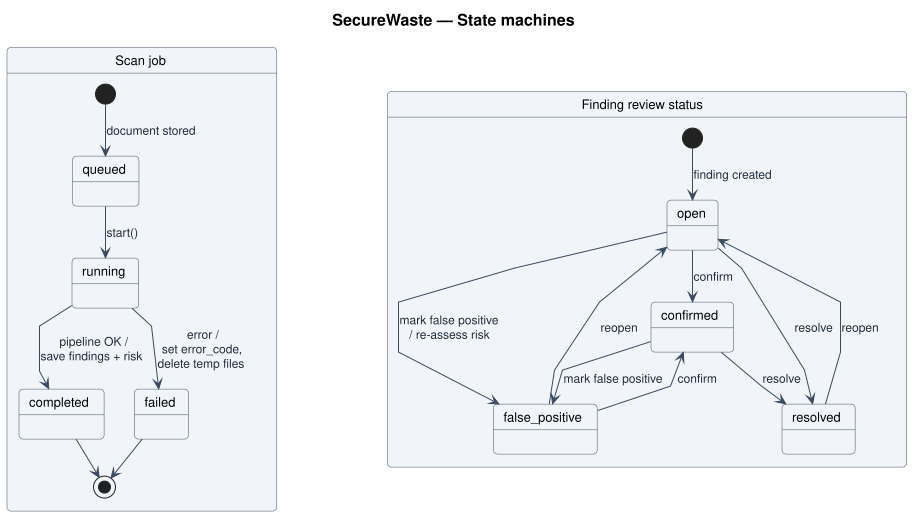

*Reading the diagram:* rounded boxes are **states**, arrows are **transitions** labelled `event [guard] / action`; the filled circle is the initial state and the ringed circle a final state.

**Scan job:** `queued → running → completed` or `failed`. A failed scan keeps an `error_code` (e.g. `PDF_ENCRYPTED`, `NO_TEXT_LAYER`, `EXTRACTION_ERROR`). Completed and failed are terminal; a re-scan creates a new job.

**Finding review status:**

| From \ To | open | confirmed | false_positive | resolved |
|---|---|---|---|---|
| open | — | ✅ | ✅ | ✅ |
| confirmed | ❌ | — | ✅ | ✅ |
| false_positive | ✅ (reopen) | ✅ | — | ❌ |
| resolved | ✅ (reopen) | ❌ | ❌ | — |

*Open* = detected potential exposure; *confirmed* = a human agrees it is real sensitive data; *false positive* = not sensitive, excluded from risk; *resolved* = remediated (redacted, removed, credential rotated). A confirmed finding is **not** automatically a security incident — that decision is outside the tool.

## 7. Data model

### 7.1 Domain classes

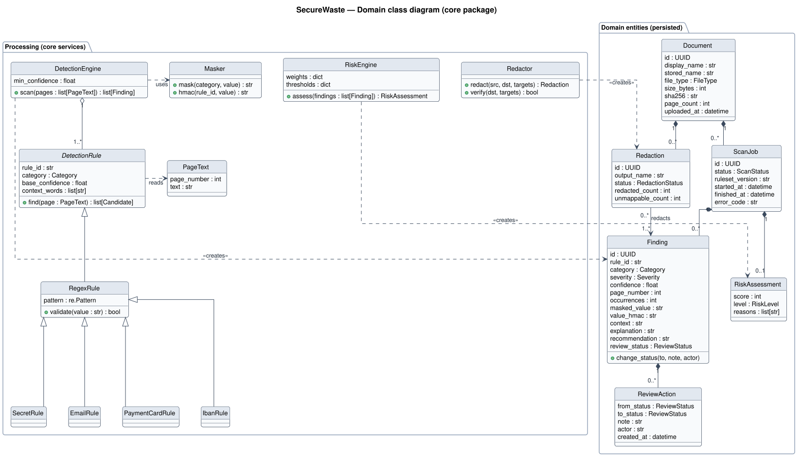

*Reading the diagram:* each box is a class with its name, attributes and operations; a hollow triangle means **inheritance** ("is a"), a filled diamond **composition** ("owns, deleted together"), a plain arrow an **association** or dependency; numbers like `1` and `0..*` are **multiplicities**.

### 7.2 Database schema

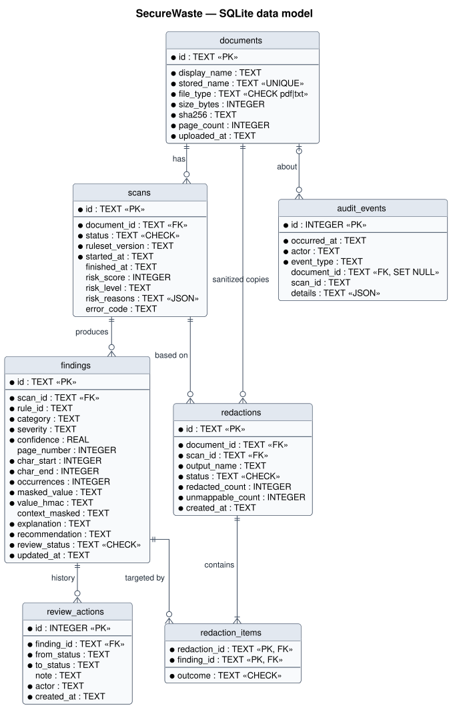

*Reading the diagram:* each box is a table; `PK` marks the primary key and `FK` a foreign key; crow's-foot ends show "many" and bars show "exactly one".

| Table | Purpose | Key rules |
|---|---|---|
| `documents` | One row per uploaded file | `stored_name` unique; `file_type IN ('pdf','txt')`; display name sanitized |
| `scans` | One row per scan run | `ON DELETE CASCADE` from documents; `status` CHECK; stores `ruleset_version`, `risk_score`, `risk_level`, `risk_reasons` (JSON) |
| `findings` | One row per merged detection | `ON DELETE CASCADE` from scans; stores **masked** value + `value_hmac`, never the raw value |
| `review_actions` | History of status changes | Append-only |
| `redactions` | One row per sanitized copy | `status IN ('verified','incomplete','failed')` |
| `redaction_items` | Outcome per finding in a redaction | `redacted` / `unmappable` / `still_present` |
| `audit_events` | Accountability trail | `document_id ON DELETE SET NULL` so events survive deletion; `details` JSON contains IDs and counts only |

Indexes: `findings(scan_id)`, `findings(category)`, `findings(review_status)`, `scans(document_id, started_at)`, `audit_events(occurred_at)`. `PRAGMA foreign_keys = ON` is set on every connection.

**Retention:** files and rows stay until the user deletes the document. Deletion removes the original, every sanitized copy and all dependent rows in one service call; the audit event survives without filename or content.

## 8. Risk scoring model

An **application-defined estimate**, not a standard. All numbers live in `core/detection/catalogue.py` and are versioned with `RULESET_VERSION`.

**Category weights (W)**

| Category | W | Default severity |
|---|---|---|
| Secret / API key / private key | 45 | critical |
| Payment card (Luhn-valid) | 40 | high |
| National ID (context-gated) | 30 | high |
| Passport (Could) | 30 | high |
| IBAN (mod-97 valid) | 25 | high |
| Confidentiality label | 10 | medium |
| Custom keyword | 8 | low (configurable per keyword) |
| Phone number | 4 | low |
| E-mail address | 3 | low |

**Algorithm**

1. Ignore findings marked *false_positive*.
2. Per category: `first = W × max_confidence`; each additional distinct finding adds `0.2 × W × its confidence`, at most 3 extras (repetition matters, but with diminishing effect).
3. **Combination bonus** +10 if two or more categories with W ≥ 25 are present.
4. **Label amplifier** +10 if a confidentiality label appears together with any W ≥ 25 category.
5. `score = min(100, round(sum))`.
6. **Floors:** a secret with High confidence ⇒ score ≥ 75; a Luhn-valid card ⇒ score ≥ 50.
7. **Levels:** 0–9 informational · 10–24 low · 25–49 medium · 50–74 high · 75–100 critical.

Every step that adds points also adds a human-readable **reason** (e.g. "+38 Payment card number (Luhn-valid, high confidence)"), and the list is shown on the risk card and in the report.

**Worked example** — synthetic invoice with an e-mail (conf 0.9), a phone number (0.6), a Luhn-valid card (0.95), a valid IBAN (0.95) and the label CONFIDENTIAL:
`2.7 + 2.4 + 38 + 23.75 + 10 + 10 (combination) + 10 (label amplifier) = 96.85 → 97 → critical`.

**Confidence** (0–1, shown as Low < 0.5 ≤ Medium < 0.8 ≤ High): each rule declares a base value and adjustments, e.g. card pattern 0.30 → 0.95 if Luhn passes (discarded if it fails); IBAN 0.40 → 0.95 if mod-97 passes; phone 0.50, +0.20 with a context word ("tel", "phone", "GSM", "mobile"); provider-specific secret prefix 0.90, generic `api_key = "…"` assignment 0.60; national ID only reported when a context word ("CIN", "carte d'identité", "national ID") is within 40 characters. Low-confidence findings drop one severity level.

## 9. Module structure

```
securewaste/                         ← repository root
├── securewaste/                     ← the Python package
│   ├── __init__.py                  create_app() application factory
│   ├── config.py                    settings from environment variables (.env)
│   ├── web/
│   │   ├── routes_dashboard.py      GET /, GET /documents
│   │   ├── routes_documents.py      upload, details, delete, rescan, redaction, report
│   │   ├── routes_api.py            JSON endpoints (/api/…)
│   │   ├── security.py              headers, CSP, error handlers
│   │   ├── templates/               Jinja2 templates (base, dashboard, upload, …)
│   │   └── static/                  css/tokens.css, css/app.css, js/*.js, icons/
│   ├── services/
│   │   ├── scan_service.py
│   │   ├── review_service.py
│   │   ├── redaction_service.py
│   │   └── audit.py
│   ├── core/
│   │   ├── errors.py                UploadRejected, ExtractionFailed, NotFound, InvalidTransition
│   │   ├── upload.py                validation + safe storage names
│   │   ├── extraction.py            PageText, extract_pages()
│   │   ├── detection/
│   │   │   ├── engine.py            DetectionEngine
│   │   │   ├── models.py            Candidate, Finding (dataclasses)
│   │   │   ├── masking.py
│   │   │   ├── validators.py        luhn_valid(), iban_valid()
│   │   │   ├── catalogue.py         weights, explanations, recommendations, RULESET_VERSION
│   │   │   └── rules/               base.py (DetectionRule), email.py, phone.py, keywords.py, payment_card.py,
│   │   │                            iban.py, secrets.py, labels.py, national_id.py
│   │   ├── risk.py                  RiskEngine, RiskAssessment
│   │   ├── redaction.py             Redactor
│   │   └── reporting.py
│   └── db/
│       ├── schema.sql
│       ├── connection.py            get_db(), init_db(), PRAGMA foreign_keys
│       └── repositories.py
├── tests/
│   ├── unit/                        rules, validators, masking, risk
│   ├── integration/                 upload → scan → DB, redaction, deletion
│   ├── security/                    no-leak greps, CSRF, headers, path traversal
│   └── fixtures/                    synthetic documents (generated, fictional data only)
├── scripts/make_fixtures.py         builds the synthetic PDFs/TXTs
├── instance/                        runtime data (git-ignored)
├── docs/                            this documentation
├── .env.example  requirements.txt  requirements-dev.txt  pyproject.toml
└── README.md  CONTRIBUTING.md  LICENSE (to add)
```

Naming conventions: modules and functions `snake_case`, classes `PascalCase`, constants `UPPER_SNAKE_CASE`, templates `kebab-case.html`, CSS classes `kebab-case` with `sw-` prefix to match the Figma tokens (`var(--sw-*)`).

## 10. Cross-cutting concerns

| Concern | Approach |
|---|---|
| **Configuration** | `config.py` reads environment variables (`SECUREWASTE_SECRET_KEY`, `SECUREWASTE_HMAC_KEY`, `MAX_UPLOAD_MB`, `MAX_PDF_PAGES`, `MIN_CONFIDENCE`, `STORAGE_DIR`, `DATABASE_PATH`); `.env` is git-ignored, `.env.example` documents every key. The app refuses to start without both keys. |
| **Error handling** | Core raises typed exceptions (`UploadRejected(code)`, `ExtractionFailed(code)`); routes map them to HTTP codes from [03-api.md](03-api.md). Generic 500 page with a correlation ID; stack traces only in the server log and only in debug mode. |
| **Logging** | Python `logging`, one line per request and per pipeline step. Never log document text, raw matches, filenames of uploads, or request bodies. A unit test asserts that no raw fixture value appears in captured logs. |
| **Security** | CSRF (Flask-WTF), CSP, security headers, safe file handling, parameterised SQL, localhost binding — detailed in the [threat model](04-threat-model.md). |
| **Transactions** | One SQLite transaction per service call; files are written to a temporary name and renamed only after the DB commit succeeds; on failure both are rolled back. |
| **Temporary files** | Created with `tempfile` inside `STORAGE_DIR/tmp`, removed in `finally` blocks; a test asserts the folder is empty after every failure path. |
| **Testing** | pytest; unit tests for every rule (positive, negative, edge cases), validators, masking and risk; integration tests with Flask's test client; synthetic fixtures only. |
| **Accessibility & UI** | Design tokens from the Figma design system (IBM Plex Sans/Mono, `--sw-*` colours); severity shown with icon + text + colour. |
| **Versioning** | Semantic Versioning for releases; `RULESET_VERSION` bumped whenever patterns, weights or thresholds change. |

## 11. Trust boundaries

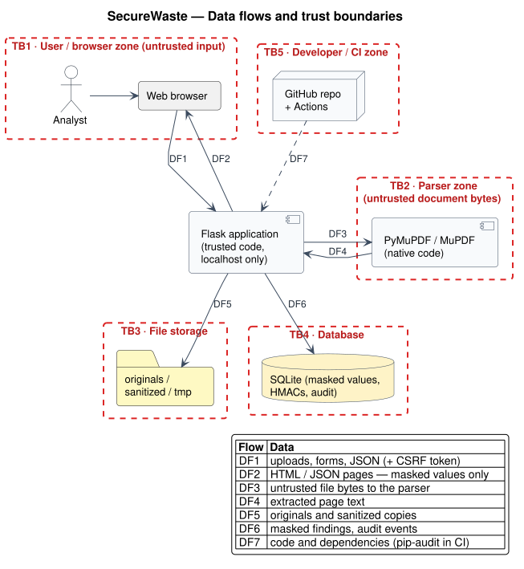

See the [threat model](04-threat-model.md) for the threats at each boundary.
