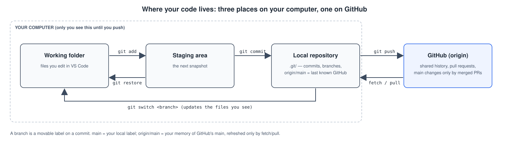
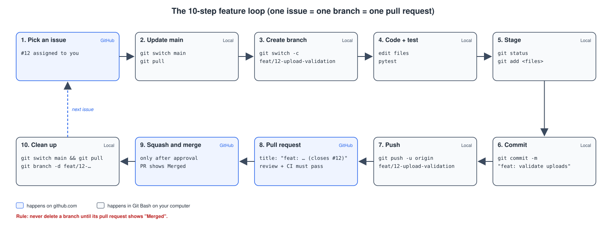

# Git & GitHub workflow guide

How the SecureWaste team of five works with Git and GitHub — from the mental model to recovering from mistakes. Part 4 walks through putting this package on GitHub for the first time on **Windows with Git Bash**.

**Contents:** [1. Mental model](#1-the-mental-model) · [2. The feature loop](#2-the-10-step-feature-loop) · [3. Command reference](#3-command-reference) · [4. First-time setup on Windows](#4-first-time-setup-windows--git-bash) · [5. Naming conventions](#5-naming-conventions) · [6. Golden rules](#6-golden-rules) · [7. Recovery toolkit](#7-recovery-toolkit) · [8. Daily checklist](#8-daily-checklist)

---

## 1. The mental model

### 1.1 Three places your code lives



| Place | What it is | Who sees it |
|---|---|---|
| **Working folder** | The files on your disk that you open in VS Code | Only you |
| **Staging area** (index) | The list of changes you have chosen for the next commit | Only you |
| **Local repository** | The `.git/` folder: every commit, every branch, on your machine | Only you — until you push |
| **GitHub** (`origin`) | The shared copy of the repository | The whole team |

A **commit** is a saved snapshot of the staged changes with a message, an author and a unique ID (a SHA such as `3f9c2ab`). Commits are cheap; make small, meaningful ones.

### 1.2 Branches: local vs origin

A **branch** is just a movable label pointing at a commit. When you work on `feat/12-upload-validation`, new commits move that label forward while `main` stays where it was.

| Name | Where it lives | Updated by |
|---|---|---|
| `main` | Your computer | `git pull` / your own commits |
| `origin/main` | Your computer — a *read-only memory* of where `main` was on GitHub the last time you talked to it | `git fetch` / `git pull` |
| `main` on GitHub | GitHub | Merged pull requests only |

`git status` saying *"Your branch is up to date with 'origin/main'"* means "up to date with what I last fetched" — not necessarily with GitHub right now. `git fetch` refreshes that memory without changing your files; `git pull` = fetch + merge into your current branch.

### 1.3 Pull requests

A **pull request (PR)** is a request on GitHub to merge one branch into another (always into `main` for us). It is where teammates review code, CI runs the tests, and discussion happens. **Squash and merge** turns all the branch's commits into one tidy commit on `main`.

---

## 2. The 10-step feature loop



| # | Where | Step | Exact commands / actions |
|---|---|---|---|
| 1 | GitHub | **Pick an issue** and assign it to yourself | Issues tab → open #12 → *Assignees* → yourself |
| 2 | Git Bash | **Update `main`** | `git switch main` then `git pull` |
| 3 | Git Bash | **Create your branch** from fresh `main` | `git switch -c feat/12-upload-validation` |
| 4 | Editor | **Code and test** in small steps | edit files · `pytest` |
| 5 | Git Bash | **Review and stage** | `git status` · `git diff` · `git add securewaste/core/upload.py tests/unit/test_upload.py` |
| 6 | Git Bash | **Commit** with a Conventional Commit message | `git commit -m "feat(upload): validate PDF magic bytes"` |
| 7 | Git Bash | **Push** (first time with `-u`) | `git push -u origin feat/12-upload-validation` (later just `git push`) |
| 8 | GitHub | **Open a pull request** to `main` | Title `feat: validate uploads by content (closes #12)`, fill the template, request a reviewer |
| 9 | GitHub | **Squash and merge** after approval + green CI | Button *Squash and merge* → confirm; PR now shows **Merged** |
| 10 | Git Bash | **Clean up** | `git switch main` · `git pull` · `git branch -d feat/12-upload-validation` |

Then go back to step 1 with the next issue.

**If `main` moved while you worked** (someone else merged first): on your branch run `git fetch` then `git merge origin/main`, fix conflicts if any, run `pytest`, commit and push. The PR updates automatically.

**Reviewing a teammate's PR:** *Files changed* tab → comment on lines → *Review changes* → Approve or Request changes. To run it locally: `git fetch` then `git switch feat/15-email-rule`.

---

## 3. Command reference

| Command | What it does | When |
|---|---|---|
| `git status` | Shows branch, staged/unstaged/untracked files | Constantly — before every add/commit |
| `git diff` | Shows unstaged changes line by line | Before staging |
| `git diff --staged` | Shows what will be committed | Before committing |
| `git add <file>` | Stages a file | Step 5 |
| `git add -p` | Stages changes piece by piece, interactively | When a file mixes two topics |
| `git restore <file>` | Discards **unstaged** changes in a file | Undo edits you don't want |
| `git restore --staged <file>` | Unstages (keeps your edits) | Staged the wrong file |
| `git commit -m "type: summary"` | Records a snapshot | Step 6 |
| `git log --oneline --graph -15` | Compact history with branches | Understanding where you are |
| `git switch <branch>` | Moves to an existing branch | Changing task |
| `git switch -c <branch>` | Creates a branch and moves to it | Step 3 |
| `git branch` / `git branch -a` | Lists local / all branches | Orientation |
| `git branch -d <branch>` | Deletes a **merged** local branch (refuses otherwise) | Step 10 |
| `git fetch` | Downloads new commits, updates `origin/*`, touches nothing else | Check what changed on GitHub |
| `git pull` | Fetch + merge into the current branch | Step 2 |
| `git push -u origin <branch>` | Uploads a new branch and links it | Step 7 |
| `git merge origin/main` | Brings latest `main` into your branch | When your PR is behind |
| `git stash` / `git stash pop` | Parks unfinished edits / brings them back | Need to switch branch quickly |
| `git remote -v` | Shows where `origin` points | Setup checks |
| `git reflog` | Lists everywhere `HEAD` has been | Recovering "lost" work |

---

## 4. First-time setup (Windows + Git Bash)

Only **one** teammate (the repository owner) does steps 4.3–4.6. The others do 4.1–4.2 and then 4.7.

### 4.1 Install the tools

| Tool | Get it | Check it works (in Git Bash) |
|---|---|---|
| **Git for Windows** (includes Git Bash and Git Credential Manager) | git-scm.com → Download for Windows → keep default options, choose *VS Code* as default editor and *main* as default branch name when asked | `git --version` |
| **Python 3.12** | python.org → Downloads → Windows installer → tick **"Add python.exe to PATH"** | `python --version` |
| **VS Code** | code.visualstudio.com | `code --version` |
| **GitHub account** | github.com → Sign up; enable two-factor authentication (Settings → Password and authentication) | — |
| Optional: **GitHub CLI** | cli.github.com | `gh --version` |
| Optional: **Java 17+** for PlantUML | adoptium.net | `java -version` |

### 4.2 Tell Git who you are (once per computer)

```bash
git config --global user.name "Your Name"            # appears in every commit
git config --global user.email "you@example.com"     # use the e-mail of your GitHub account
git config --global init.defaultBranch main           # new repositories start on 'main'
git config --global pull.rebase false                 # 'git pull' merges (simplest for beginners)
git config --global core.editor "code --wait"         # VS Code opens for long commit messages
git config --list --global                            # check the result
```

Tip: in GitHub → Settings → Emails you can tick *Keep my email addresses private* and use the `…@users.noreply.github.com` address instead.

### 4.3 Create the empty repository on GitHub

1. github.com → **+** (top right) → **New repository**.
2. Owner: you (or a team organisation). Name: `securewaste`. Description: *Sensitive data exposure prevention platform — DLP-style portfolio project*.
3. **Public** (portfolio) or Private (until you are ready).
4. **Do not** tick "Add a README", ".gitignore" or "license" — the package already has them; an initialised repository would conflict with the first push.
5. Click **Create repository** and keep the page open (it shows the URL `https://github.com/<you>/securewaste.git`).

### 4.4 Put the package in a folder

1. In File Explorer, create `C:\Users\<you>\projects\securewaste`.
2. Right-click `securewaste-milestone0.zip` → **Extract All…** → choose that folder. You should see `README.md`, `docs\`, `.github\`, `.gitignore` directly inside it (hidden files: View → Show → Hidden items).
3. Open Git Bash there: right-click inside the folder → *Open Git Bash here* (Windows 11: *Show more options* first). Check:

```bash
pwd          # /c/Users/<you>/projects/securewaste
ls -a        # README.md  CONTRIBUTING.md  docs  .github  .gitignore  .gitattributes  .env.example
```

### 4.5 First commit and push

```bash
git init                         # creates the hidden .git/ folder: this folder is now a repository
git status                       # everything is "untracked" (red): Git sees the files but doesn't track them yet
git add .                        # stage every file ('.' = this folder); .gitignore keeps secrets/junk out
git status                       # now green: staged for the first commit
git commit -m "docs: add Milestone 0 documentation package"   # first snapshot
git branch -M main               # make sure the branch is called 'main'
git remote add origin https://github.com/<you>/securewaste.git   # 'origin' = nickname for the GitHub copy
git remote -v                    # check the URL (fetch + push lines)
git push -u origin main          # upload; -u links local main to origin/main for future 'git push'/'git pull'
```

The first push opens a **Git Credential Manager** window: choose *Sign in with your browser* and authorise. Refresh the GitHub page: the README is rendered with its diagrams.

**Check the secrets rule works:** `echo "SECUREWASTE_SECRET_KEY=test" > .env` then `git status` — `.env` must **not** appear. Delete it afterwards (`rm .env`).

### 4.6 Configure the repository for a team

1. **Collaborators:** Settings → Collaborators (or the organisation's *People*) → invite the four teammates with *Write* access.
2. **Protect `main`:** Settings → Branches (or *Rules → Rulesets*) → add a rule for `main`: require a pull request before merging, require **1 approval**, require status checks to pass (once CI exists), block force pushes and deletion.
3. **Merge button:** Settings → General → Pull Requests → keep only **Allow squash merging**; tick *Automatically delete head branches* (GitHub deletes the remote branch *after* merge).
4. **Security:** Settings → Code security → enable *Dependabot alerts* and *Secret scanning* where available.
5. **Labels:** Issues → Labels → add `type: feature`, `type: bug`, `type: task`, `priority: must`, `priority: should`, `priority: could`, `security`.
6. **Milestones:** Issues → Milestones → create *M1 — Walking skeleton*, *M2 — Detection & risk*, … *M5 — Hardening & release*. Leave dates empty until agreed.
7. **Project board (optional):** Projects → New project → *Board* with columns Todo / In progress / In review / Done.

### 4.7 Teammates: clone the repository

```bash
cd ~/projects                                                  # choose where projects live
git clone https://github.com/<owner>/securewaste.git           # downloads the whole history
cd securewaste
git log --oneline                                              # you should see the Milestone 0 commit
```

### 4.8 Tech lead: merge the skeleton before anyone else codes

The skeleton (package layout, configuration, security middleware, database schema, shared contracts, tests and CI) is the tech lead's first pull request. Nobody starts a feature branch until it is on `main`, so every branch begins from the same structure.

**Tech lead** (in the repository folder, on an up-to-date `main`):

```bash
git switch main && git pull
git switch -c chore/1-project-skeleton           # issue #1
# unzip the new package over the folder, replacing files when Windows asks
git status                                       # new: securewaste/, tests/, .github/workflows/, requirements*.txt …
python -m venv .venv && source .venv/Scripts/activate
pip install -r requirements-dev.txt
cp .env.example .env                             # put two generated keys in it (README → Running locally)
pytest && ruff check .                           # must be green before pushing
git add .
git commit -m "chore: add project skeleton with app factory, schema, contracts and CI"
git push -u origin chore/1-project-skeleton
```

Open the PR `chore: add project skeleton (closes #1, closes #2)`. Ask one teammate to review it: reviewing the skeleton is the best way for them to learn the structure. Squash and merge once CI is green.

Then, on GitHub:
1. Edit `.github/CODEOWNERS` and replace `@TECH-LEAD-USERNAME` with your real username (one small PR).
2. Settings → Branches → the `main` rule → tick **Require status checks** (choose `test`) and **Require review from Code Owners**.

**Every teammate**, once the skeleton PR shows **Merged**:

```bash
git switch main && git pull                       # you now have the skeleton
python -m venv .venv && source .venv/Scripts/activate
pip install -r requirements-dev.txt
cp .env.example .env                              # your own keys; .env never leaves your machine
flask --app securewaste init-db && pytest         # green = your setup works
git switch -c feat/3-upload-validation            # your issue, from the fresh main
```

From here everyone follows the 10-step loop. Each person edits the stub files of their own issue (see the ownership table in [CONTRIBUTING.md](../../CONTRIBUTING.md#roles-the-tech-lead-owns-the-structure-everyone-owns-a-module)), so pull requests rarely conflict. A change to a shared contract goes in its own small PR, reviewed by the tech lead.

### 4.9 Proposed first five issues for Milestone 1

Copy each into GitHub (*New issue → User story / Task*), or see [milestone-1-issues.md](milestone-1-issues.md) for ready-to-paste bodies.

| # | Title | Type · Priority | Done when |
|---|---|---|---|
| 1 | `chore: project skeleton with Flask app factory, config and pytest` — **tech lead, delivered by the skeleton PR** | Task · Must | `flask --app securewaste run` serves `/healthz`; config read from `.env`; app refuses to start without keys; `pytest` runs one passing test; `requirements*.txt` pinned |
| 2 | `ci: run pytest and pip-audit on every pull request` — **tech lead, delivered by the skeleton PR** | Task · Must | Workflow in `.github/workflows/ci.yml`; green on a PR; `main` protection requires it |
| 3 | `feat: validated PDF/TXT upload stored outside the web root` (US-01, US-02, FR-01–06) | Feature · Must | Upload form; size, magic-byte, UTF-8, encryption and page checks with documented error codes; UUID names in `instance/storage/originals`; SHA-256 computed; tests ST-03, ST-04, ST-14, ST-15 pass; `tmp/` empty after failures |
| 4 | `feat: page-aware text extraction for PDF and TXT` (US-03, FR-07) | Feature · Must | `extract_pages()` returns `PageText` per page; empty/scanned PDF → `NO_TEXT_LAYER`; character cap; synthetic multi-page fixture tested |
| 5 | `feat: first detection rules — e-mail, phone, keywords — with masking` (US-04, FR-08, FR-13) | Feature · Must | `Finding` dataclass; three rules with positive/negative/edge tests; masked values only; duplicates merged; findings shown as JSON or a simple page after upload |

---

## 5. Naming conventions

### 5.1 Branches: `type/<issue-number>-short-name`

| Type | Use | Example |
|---|---|---|
| `feat/` | New capability | `feat/12-upload-validation` |
| `fix/` | Bug fix | `fix/31-luhn-off-by-one` |
| `docs/` | Documentation | `docs/7-update-threat-model` |
| `test/` | Tests only | `test/40-redaction-recovery` |
| `refactor/` | Restructure without behaviour change | `refactor/22-repository-layer` |
| `chore/` / `ci/` | Tooling, dependencies, CI | `ci/2-github-actions` |

Lowercase, hyphens, no spaces, short (3–5 words). One issue → one branch → one PR.

### 5.2 Commit messages: Conventional Commits

```
<type>(<optional scope>): <imperative summary, lowercase, no final period>
```

- `feat(detection): add IBAN rule with mod-97 validation`
- `fix(upload): reject PDFs with zero pages`
- `test(risk): cover label amplifier`
- `docs(adr): record decision to use Flask-WTF`

Imperative = "add", not "added"/"adds" (complete the sentence *"If applied, this commit will …"*). Summary ≤ 72 characters. Add a body after a blank line to explain **why** when it isn't obvious.

### 5.3 Pull request titles

Same format as a commit (it *becomes* the squash commit on `main`), plus the issue: `feat: validate uploads by content (closes #12)`. In the description write `Closes #12` on its own line — GitHub closes the issue automatically when the PR is merged.

### 5.4 Files and code

| Thing | Convention | Example |
|---|---|---|
| Python modules / packages | `snake_case` | `scan_service.py`, `core/detection/` |
| Functions, variables | `snake_case` | `extract_pages()`, `min_confidence` |
| Classes | `PascalCase` | `DetectionEngine`, `RiskAssessment` |
| Constants | `UPPER_SNAKE_CASE` | `MAX_UPLOAD_MB`, `RULESET_VERSION` |
| Tests | `tests/<kind>/test_<module>.py`, functions `test_<behaviour>` | `test_luhn_rejects_invalid_checksum` |
| Templates, CSS, JS files | `kebab-case` | `document-detail.html`, `review.js` |
| CSS classes | `kebab-case` with `sw-` prefix | `sw-severity-badge` |
| Docs | `NN-kebab-case.md`, ADRs `NNNN-kebab-case.md` | `02-architecture.md`, `0004-pymupdf-….md` |
| Diagrams | same stem across `src/`, `svg/`, `png/`, `drawio/` | `seq-upload-scan.*` |
| Environment variables | `UPPER_SNAKE_CASE`, app ones prefixed `SECUREWASTE_` | `SECUREWASTE_SECRET_KEY` |

---

## 6. Golden rules

1. **Never commit directly to `main`.** Branch protection enforces it; your habit should too.
2. **Never delete a branch until its pull request shows "Merged".** A closed-but-not-merged PR, or a PR still open, means the branch holds work that exists nowhere else. `git branch -d` (lowercase) refuses to delete unmerged work — never "fix" that with `-D` unless you are sure.
3. **Pull before you branch.** Start every branch from an up-to-date `main` (step 2).
4. **Small PRs.** Under ~300 changed lines; one topic. Reviewers catch more and merge faster.
5. **Never commit secrets or real data.** `.env` is ignored; fixtures are synthetic. If a secret was pushed: **rotate it first**, then clean history.
6. **Never force-push to a shared branch** (`git push --force` rewrites others' history).
7. **Run `pytest` before pushing.** CI is a safety net, not your first test.

---

## 7. Recovery toolkit

| Situation | Fix |
|---|---|
| Edited a file and want the last committed version back | `git restore <file>` (edits are lost) |
| Staged the wrong file | `git restore --staged <file>` |
| Typo in the last commit message, **not pushed** | `git commit --amend -m "fix: correct message"` |
| Forgot a file in the last commit, **not pushed** | `git add <file>` then `git commit --amend --no-edit` |
| Last commit was wrong, **not pushed**, keep the changes | `git reset --soft HEAD~1` (changes return to staging) |
| A bad commit is **already pushed / merged** | `git revert <sha>` — creates a new commit that undoes it; history stays honest |
| Committed on `main` by mistake (not pushed) | `git switch -c feat/N-name` (branch keeps the commit) → `git switch main` → `git reset --hard origin/main` |
| Need to switch branch with unfinished work | `git stash` → switch → later `git stash pop` |
| "Lost" a commit or deleted a branch too early | `git reflog` → find the SHA (e.g. `a1b2c3d HEAD@{5}: commit: feat: …`) → `git branch rescue a1b2c3d` |
| "You are in 'detached HEAD' state" | You checked out a commit, not a branch. Keep work: `git switch -c rescue-branch`; otherwise `git switch main` |
| Merge conflict | Open the file, find `<<<<<<<`, `=======`, `>>>>>>>`, keep the right code, delete the markers → `git add <file>` → `git commit` (or abort with `git merge --abort`) |
| `git push` rejected (non-fast-forward) | Someone pushed first: `git pull` (merge), fix conflicts, `pytest`, `git push` |
| A secret was pushed | 1. **Revoke/rotate it now** (the leak already happened). 2. Tell the team. 3. Remove it from history with `git filter-repo` or ask a maintainer; 4. Add the pattern to `.gitignore` |

`git reflog` is your safety net: Git keeps unreachable commits for weeks, so almost nothing committed is truly lost.

---

## 8. Daily checklist

**Start of session**
- [ ] `git switch main && git pull`
- [ ] Check the board / your assigned issues; reply to review comments
- [ ] Continue your branch (`git switch feat/N-…`) or start a new one from fresh `main`
- [ ] If your branch is old: `git fetch && git merge origin/main`
- [ ] Activate the virtual environment: `source .venv/Scripts/activate`

**While working**
- [ ] Small commits with Conventional Commit messages
- [ ] `git status` before every `git add` — no `.env`, no `instance/`, no real documents
- [ ] `pytest` before every push

**End of session**
- [ ] Push your branch (even unfinished — it is your backup); open a **draft** PR if you want feedback
- [ ] Update the issue with a one-line status
- [ ] Review at least one teammate's PR
- [ ] After a merge: `git switch main && git pull && git branch -d <merged-branch>` — only once the PR says **Merged**
